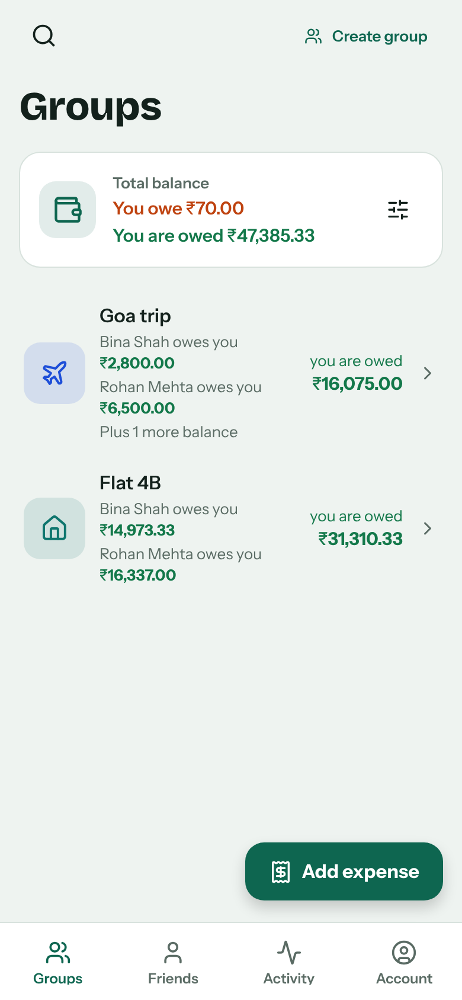
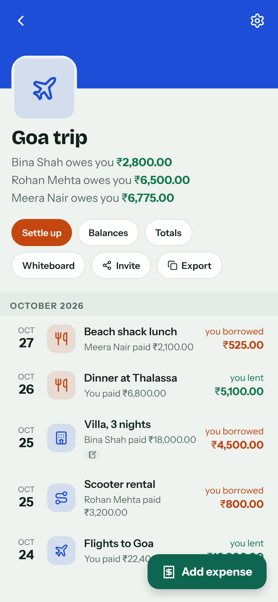
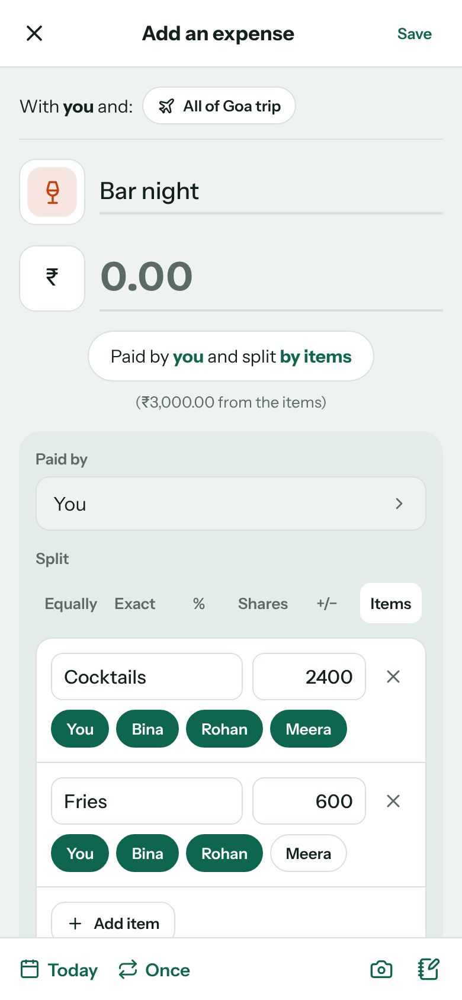
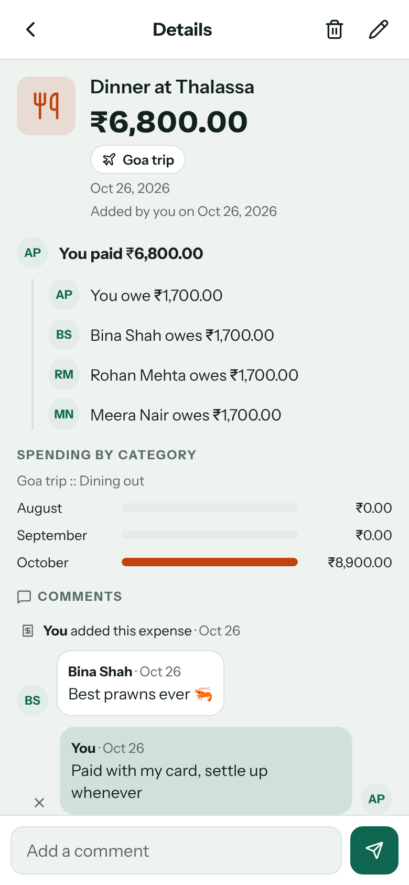
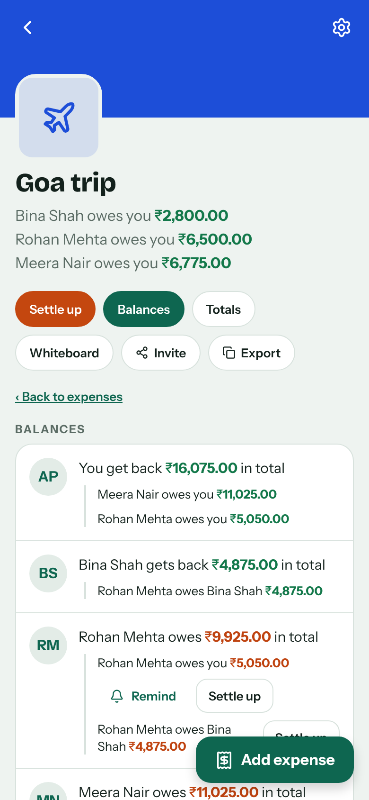
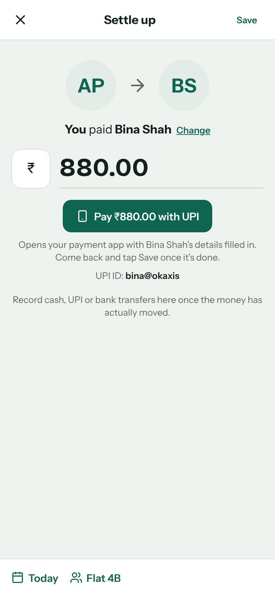
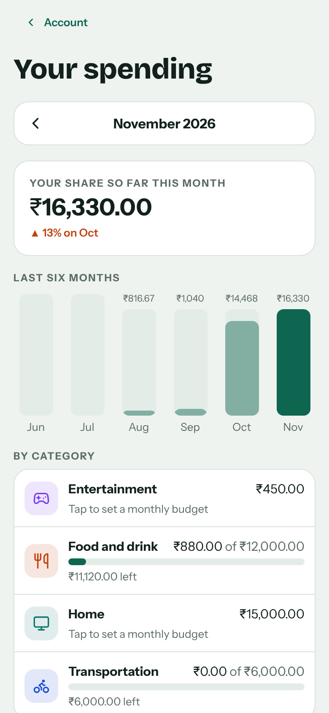
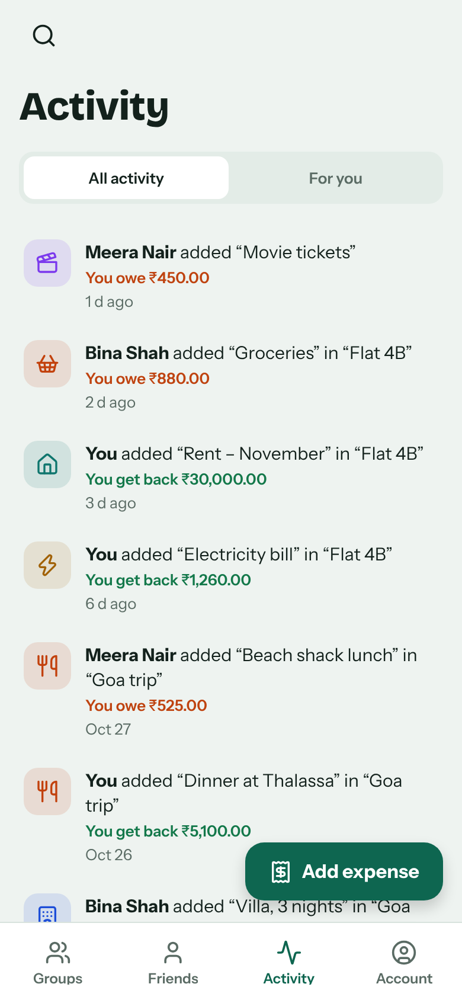
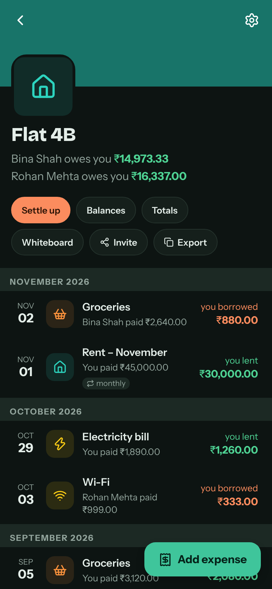

# Evenly

**Evenly is a free mobile and web app that tracks shared expenses, IOUs and running balances among
roommates, friends, couples and travel groups.** Add a bill, choose how to split it, and Evenly keeps a
live tally of who owes whom, then works out the fewest payments to settle up.

**Try it:** <https://evenly-tracker.netlify.app>. It works in any browser, installs on your phone's Home
Screen, and is also available as an Android app.

<table>
  <tr>
    <td align="center"> Your groups and balances</td>
    <td align="center"> A group's expenses</td>
    <td align="center"> Split by items</td>
  </tr>
  <tr>
    <td align="center"> Details and comments</td>
    <td align="center"> Balances</td>
    <td align="center"> Settle up, pay with UPI</td>
  </tr>
  <tr>
    <td align="center"> Spending and budgets</td>
    <td align="center"> Activity</td>
    <td align="center"> Dark mode</td>
  </tr>
</table>

## Features

**Splitting**
- One-to-one with a friend, or in a group (trip, home, couple, other)
- Split equally, by exact amounts, percentages or shares, equally with +/− adjustments, or item by item
  (tax and tip shared in proportion)
- Several people paying for one expense, and one bill with several friends outside any group
- Save a group's usual split as the default for new expenses
- Recurring expenses: weekly, every 2 weeks, monthly or yearly
- About 45 categories with icons, guessed from the description
- Simplified debts: the fewest payments to settle everything, switchable per group

**Money**
- Any currency on any expense, with balances kept per currency
- Today's exchange rates to convert an expense, and an overall total in your own currency
- Pay with UPI, PayPal or Venmo straight from Settle up
- Monthly spending by category, a six-month chart and optional budgets
- Group totals: who paid what, each person's share, month by month

**Together**
- Find friends by name; invite anyone else with a link or QR code
- Phone notifications and emails when you're added to an expense, it changes, someone comments,
  or someone reminds you to pay
- Comments on expenses, alongside a full history of every change
- Receipt photos (private to the group), notes, group cover photos and a shared whiteboard
- Restore deleted expenses
- An activity feed across all your friends and groups

**Everywhere**
- Sign in with email or Google
- Android app, plus a website that installs on any phone's Home Screen
- Works offline: your balances stay visible, and changes sync when you're back online
- Light and dark themes
- Export a group as a spreadsheet, or download a backup of all your data

## How it's built

| Part | What it uses |
|---|---|
| App (web, Android, iPhone) | [Expo](https://expo.dev) and React Native, written in TypeScript. One code base in `mobile/` |
| Accounts, database, photos | [Supabase](https://supabase.com): Postgres with row level security, so people only see groups they belong to |
| Notifications and email | The `notify` Supabase Edge Function: web push, Expo push for the app, and email through Brevo |
| Website hosting | [Netlify](https://netlify.com), rebuilt automatically from `main` |
| Android builds | Expo's build service, started from GitHub Actions |

Everything runs on free plans.

## Privacy

Evenly only stores what it needs to work out balances, has no ads, and doesn't sell or share data.
Read the full [privacy policy](https://evenly-tracker.netlify.app/privacy.html).
